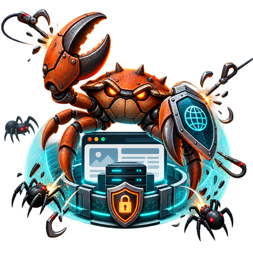

<p align="center">
  
</p>

# AI Scraping Defense Rust

AI Scraping Defense Rust is a defensive service stack for detecting, throttling, deceiving, and blocking unwanted AI crawlers and automated scraping traffic. It combines request scoring, Redis-backed blocklists, webhook-driven security actions, tarpit content generation, CAPTCHA challenges, payment-aware crawler access, provider-aware model routing, admin operations, and edge automation services into a deployable Rust workspace.

The project is designed for operators who need a fast, explicit, service-based control plane around bot detection and response. It can run locally with Cargo, as a Docker Compose stack, or as Kubernetes/Helm workloads.

## Scope

Implemented baseline services:

- `escalation-engine`: `/escalate`, `/metrics`, `/admin/reload_plugins`
- `ai-service`: `/health`, `/webhook`
- `tarpit-api`: `/health`, `/`, `/tarpit/*path`
- `admin-ui`: dashboard, settings, logs, plugins, blocklist endpoints
- `captcha-service`: `/challenge`, `/solve`, `/verify`
- `cloud-dashboard`: installation registration and metrics fanout endpoints
- `cloud-proxy`: `/health`, `/api/chat`
- `config-recommender`: `/recommendations`
- `config-recommender`: authenticated `POST /incident/evaluate` accepts recent traffic windows and delivers deduplicated operator alerts to `ADMIN_ALERT_WEBHOOK_URL`. Escalation sends live request-window signals when `INCIDENT_EVALUATOR_API_KEY` is configured. Alerts offer manual Cloudflare Under Attack Mode review and, when configured origin health checks show primary unhealthy and backup healthy, manual failover review. Window aggregation and alert deduplication are process-local; use one replica of each service or add a shared incident store before scaling horizontally.
- `edge-ops`: robots/rules fetching, WAF/CDN/TLS/DDoS operations, blocklist sync
- `pay-per-crawl`: crawler registration, payment, proxy charging
- `prompt-router`: `/health`, `/route`
- `public-blocklist`: `/list`, `/list/auth`, `/report`
- `rag-trainer`: request labeling, reviewed-label model training, training ingest, fine-tuning JSONL export

The codebase also tracks API and deployment compatibility with the original Python `ai-scraping-defense` implementation. See [docs/PARITY.md](docs/PARITY.md) for the current parity map.

## Layout

- `crates/asd-core`: shared config, health responses, HMAC, blocklist state
- `crates/asd-detection`: feature extraction, fingerprinting, scoring
- `crates/asd-tarpit`: deterministic tarpit page and fake asset generation
- `services/*`: one binary per runtime service
- `config/`: sample runtime configuration
- `docker-compose.yaml`: local stack similar to the Python composition
- `kubernetes/` and `helm/`: starter deployment artifacts

## Quick Start

```powershell
cp config/sample.env .env
python scripts/configure_credentials.py
cargo run -p escalation-engine
```

Run the local stack:

```powershell
docker compose up --build
```

Run a health smoke check against the default ports:

```powershell
.\scripts\parity_smoke.ps1
```

Detailed setup, configuration, API examples, Docker, and Kubernetes usage are in [docs/USAGE.md](docs/USAGE.md).

## Release Artifacts

Tagged releases publish:

- `ghcr.io/rhamenator/ai-scraping-defense-rust` container images for the full multi-service runtime image.
- Linux x64, Windows x64, macOS Intel, and macOS Apple Silicon release bundles containing all service binaries plus checksums.

Push a tag such as `v1.0.0` to publish a stable image with version, minor, and `latest` tags. Prerelease tags such as `v1.0.0-rc.1` publish prerelease image and binary assets without moving `latest`.

## Verification

```powershell
cargo fmt --all -- --check
cargo clippy --workspace --all-targets -- -D warnings
cargo test --workspace
```

If Windows reports a missing Rust toolchain manifest, repair or reinstall the pinned toolchain first:

```powershell
rustup toolchain uninstall 1.88.0-x86_64-pc-windows-msvc
rustup toolchain install 1.88.0-x86_64-pc-windows-msvc
```

## License

This project is licensed under the GNU General Public License v3.0 or later. See [LICENSE](LICENSE).
